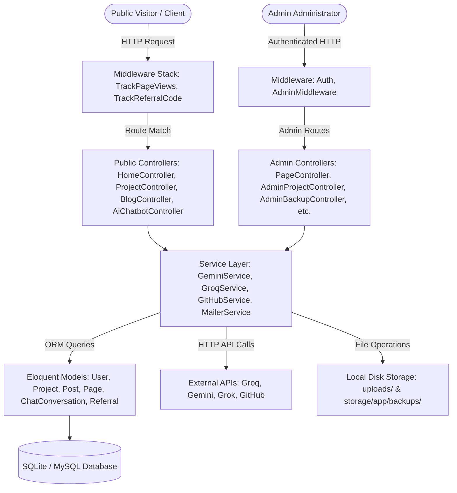
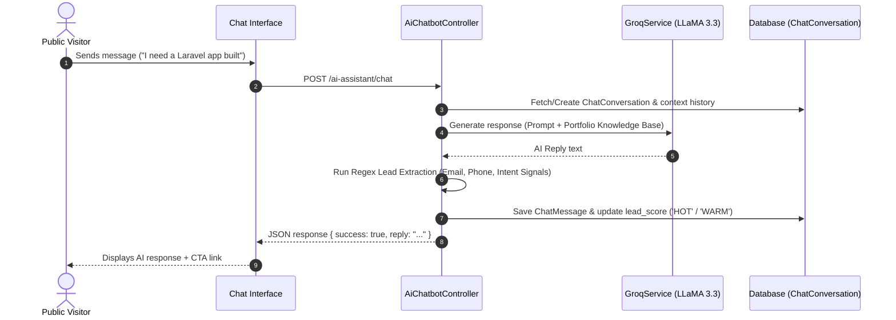
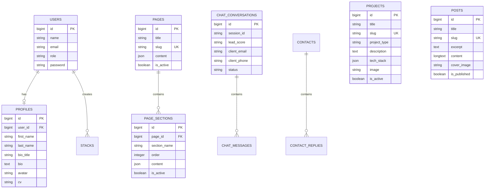

# Kelvin Portfolio — Developer Portfolio & AI-Powered CMS Platform

[](https://laravel.com)
[](https://php.net)
[](https://vitejs.dev)
[](https://tailwindcss.com)
[](LICENSE)

A production-grade, full-stack Developer Portfolio, Content Management System (CMS), and AI-powered Lead Generation Platform built with **Laravel 13.x**, **PHP 8.3+**, **Vite**, and **Tailwind CSS**.

The platform combines a public-facing developer portfolio and technical blog with an administrative management backend, an automated **AI Sales Assistant** integrating **Groq LLaMA 3.3 70B** and **Google Gemini 3.6 Flash**, lead scoring, analytics tracking, affiliate link management, and automated database snapshot capabilities.

---

## 📋 Table of Contents

- [Overview & Architecture](#-overview--architecture)
- [Key Features](#-key-features)
  - [Public Portfolio & CMS](#1-public-portfolio--cms)
  - [AI Sales Assistant & Lead Generation](#2-ai-sales-assistant--lead-generation)
  - [Admin Management Panel](#3-admin-management-panel)
  - [Analytics, Security & Database Snapshots](#4-analytics-security--database-snapshots)
- [Technology Stack](#-technology-stack)
- [System Architecture & Data Flow](#-system-architecture--data-flow)
- [Database Schema & ER Diagram](#-database-schema--er-diagram)
- [Installation & Local Setup](#-installation--local-setup)
- [Environment Configuration](#-environment-configuration)
- [API & Route Reference](#-api--route-reference)
- [Security Mechanisms](#-security-mechanisms)
- [Performance & Caching Strategy](#-performance--caching-strategy)
- [Testing](#-testing)
- [Project Structure](#-project-structure)
- [Engineering Decisions](#-engineering-decisions)

---

## 🔭 Overview & Architecture

**Kelvin Portfolio** is designed to solve a core problem for modern software engineers: converting technical portfolio traffic into qualified business opportunities while serving as a dynamic content management system for projects, articles, code snippets, and work experiences.

### Architectural Highlights

- **MVC + Service Layer Pattern**: Strict separation between controller HTTP routing, business logic service classes (`GroqService`, `GeminiService`, `GitHubService`, `MailerService`), and Eloquent database models.
- **Dynamic Content Engine**: Pages and layout sections are stored as structured JSON payloads in SQLite/MySQL databases, allowing real-time text and section ordering changes without redeploying code.
- **Multi-Provider AI Service Layer**: Pluggable support for **Groq Cloud API** (`llama-3.3-70b-versatile`), **Google Gemini API** (`gemini-3.6-flash`), and **xAI Grok** (`grok-2-latest`) for both conversational AI lead generation and AI article/copy generation.
- **Automated Lead Scoring Engine**: Natural language processing regex triggers extract contact numbers, emails, project scopes, and budget intent signals from AI chat interactions, categorizing leads into `HOT`, `WARM`, or `COLD` stages.

---

## ✨ Key Features

### 1. Public Portfolio & CMS
- **Home & Bio Presentation**: Displays profile summary, tech stack highlights, featured project cards, and direct CV download.
- **Projects Showcase**: Interactive list supporting category filtering (`web`, `mobile`, `desktop`, `other`), tech stack tags, client testimonials, metrics, GitHub links, and live preview modal embeds.
- **Technical Blog**: Markdown-supported technical articles with view counters, search, category filters, and related posts.
- **Code Snippets Library**: Searchable repository of reusable code snippets with syntax highlighting and copy triggers.
- **Book a Call Scheduler**: Integrated discovery call scheduler supporting external tools (Calendly).
- **Live GitHub Integration**: Server-side cached integration (`GitHubService` with `Cache::remember`) displaying real-time GitHub repositories, star counts, primary languages, and update timestamps.

### 2. AI Sales Assistant & Lead Generation
- **24/7 AI Chatbot Interface**: Real-time conversational widget (`/ai-assistant/chat`) powered by **Groq LLaMA 3.3 70B** with full multi-turn conversation memory (`ChatConversation` and `ChatMessage` models).
- **Automated Lead Qualification**: Evaluates visitor responses across 4 qualification stages (Discovery, Goal, Scope, Call to Action) and automatically extracts phone numbers and email addresses.
- **AI Content Generator**: Admin suite tools allowing 1-click generation of blog posts, article excerpts, project case study copy, and professional bio summaries via Google Gemini.

### 3. Admin Management Panel
- **Executive Analytics Dashboard**: Real-time metrics for total page views, unread messages, active projects, published blog posts, and active AI lead conversations.
- **Visual Page Builder**: Dynamic section manager (`/admin/pages`) to configure page SEO metadata (title, meta description, keywords, robots directives) and re-order page sections.
- **Project & Case Study Manager**: File upload integration (`HasImageUpload` trait) supporting custom cover images, client feedback, metrics, and structured project sections.
- **Blog & Snippet CMS**: Full CRUD administration for blog posts and code snippets.
- **Contact Messages & Threaded Email Replies**: Centralized inbox (`/admin/messages`) with custom email template composition and direct email reply dispatch.
- **Work Experience & Tech Stack Managers**: Dedicated CRUD views for managing career history and skill tags.

### 4. Analytics, Security & Database Snapshots
- **Visitor Analytics**: Middleware-based page view counter (`TrackPageViewsMiddleware`) logging URI visits, referrer sources, user agents, and IP addresses.
- **Affiliate & Referral Engine**: Middleware (`TrackReferralCode`) tracking referral links via URL parameters and persistent browser cookies.
- **Database Safety Snapshots**: One-click database backup module (`/admin/backup`) allowing instant `.sqlite` snapshot creation, downloads, safety restore points, and deletions.

---

## 🛠️ Technology Stack

| Domain | Technologies |
|---|---|
| **Backend Framework** | Laravel 13.8, PHP 8.3+ |
| **Authentication & Auth** | Laravel Breeze, Laravel Sanctum |
| **Frontend UI** | Blade Templates, Vite 6, Tailwind CSS 4, Alpine.js, Vanilla JavaScript |
| **Database & ORM** | SQLite (default local) / PostgreSQL / MySQL support via Eloquent ORM |
| **AI & LLM Services** | Groq Cloud API (`llama-3.3-70b-versatile`), Google Gemini API (`gemini-3.6-flash`), xAI Grok (`grok-2-latest`) |
| **Integrations** | GitHub REST API v3, SMTP Mailer |
| **Caching & Queues** | Laravel Database Cache, Session Database Driver, Database Queue Worker |
| **Development & Tooling** | PHPUnit 12, Laravel Pint, Concurrently, Vite |

---

## 📐 System Architecture & Data Flow



### AI Lead Qualification Flow



---

## 🗄️ Database Schema & ER Diagram



---

## ⚡ Installation & Local Setup

### System Requirements
- **PHP**: `>= 8.3` (with `pdo_sqlite`, `mbstring`, `openssl`, `curl` extensions)
- **Composer**: `>= 2.x`
- **Node.js**: `>= 18.x` & `npm`

### Step-by-Step Installation

1. **Clone the repository:**
   ```bash
   git clone https://github.com/kelvo4799/kelvinaso.git
   cd kelvinaso
   ```

2. **Install PHP dependencies:**
   ```bash
   composer install
   ```

3. **Install JavaScript dependencies:**
   ```bash
   npm install
   ```

4. **Set up environment configuration:**
   ```bash
   cp .env.example .env
   php artisan key:generate
   ```

5. **Initialize the SQLite database:**
   ```bash
   touch database/database.sqlite
   php artisan migrate --seed
   ```
   *The seeder creates default admin credentials (`admin@admin.com` / `Admin123$`) and pre-populates all public pages, project templates, and system settings.*

6. **Build frontend assets:**
   ```bash
   npm run build
   ```

7. **Run the development environment:**
   Use the built-in Composer script to launch the HTTP server, queue listener, log viewer, and Vite dev server concurrently:
   ```bash
   composer run dev
   ```

   The application will be accessible at: `http://localhost:8000`

---

## 🔑 Environment Configuration

Below are the key environment variables used by the application:

| Variable | Description | Default | Required |
|---|---|---|---|
| `APP_ENV` | Application environment (`local`, `production`) | `local` | Yes |
| `APP_KEY` | Application encryption key | Generated via artisan | Yes |
| `APP_URL` | Application base URL | `http://localhost:8000` | Yes |
| `DB_CONNECTION` | Database connection driver (`sqlite`, `mysql`, `pgsql`) | `sqlite` | Yes |
| `QUEUE_CONNECTION` | Queue processing connection (`database`, `sync`) | `database` | Yes |
| `GROQ_API_KEY` | Groq Cloud API key for LLaMA 3.3 AI Chatbot | — | Optional (For AI Chatbot) |
| `GEMINI_API_KEY` | Google Gemini API key for AI Copy Generation | — | Optional (For AI Generator) |
| `GROK_API_KEY` | xAI Grok API key | — | Optional |
| `MAIL_MAILER` | Mail driver (`smtp`, `log`) | `log` | Yes |

---

## 📡 API & Route Reference

### Public Routes
- `GET /` — Home page
- `GET /projects` — Projects portfolio index
- `GET /projects/{slug}` — Project case study detail
- `GET /about` — Biography, skills & experience page
- `GET /blog` — Articles index
- `GET /blog/{slug}` — Article detail view
- `GET /snippets` — Code snippets library
- `GET /book-call` — Scheduling page
- `POST /api/contact/send` — Submit contact inquiry (Rate limited)
- `POST /ai-assistant/chat` — AI Sales Chatbot interaction endpoint
- `GET /ai-assistant/history` — Fetch session chat history

### Admin Routes (`/admin/*` — Requires `auth` & `admin` role)
- `GET /admin/dashboard` — Main executive metrics dashboard
- `GET /admin/pages` — CMS Pages list
- `POST /admin/pages` — Store new static page
- `PATCH /admin/pages/{slug}` — Update page metadata & section content
- `GET /admin/projects` — Projects management
- `POST /admin/projects` — Create project
- `GET /admin/blog` — Blog CMS manager
- `POST /admin/ai/generate-blog` — AI blog generation endpoint
- `GET /admin/messages` — Contact submissions inbox
- `POST /admin/messages/{id}/reply` — Dispatch email reply to lead
- `GET /admin/backup` — Database snapshot management page
- `POST /admin/backup/create` — Generate instant `.sqlite` DB backup
- `POST /admin/backup/restore/{filename}` — Restore database from snapshot

---

## 🔒 Security Mechanisms

- **Authentication & Role Authorization**: Routes are protected using Laravel Sanctum/Breeze session middleware. Admin routes enforce the custom `AdminMiddleware`, ensuring non-admin users cannot access administrative controllers.
- **Form Validation & Sanitization**: All form inputs pass through strict FormRequests (`AdminProjectRequest`, `ContactRequest`, `PostRequest`, `PageDetailRequest`).
- **Submission Rate Limiting**: The public contact API endpoint enforces multi-layered rate limiting (`ContactController`) across IP addresses, User-Agents, and Email hashes using `Illuminate\Support\Facades\RateLimiter`.
- **CSRF Protection**: All state-modifying requests require valid CSRF tokens (`PreventRequestForgery`).
- **File Upload Validation**: Images and documents uploaded via `HasImageUpload` and `ImageUploadService` undergo strict mime-type checks (`jpg`, `png`, `webp`, `pdf`), size validation caps (up to 10MB/20MB), and path sanitization.
- **AI System Guardrails**: System prompts in `AiChatbotController` include explicit directives preventing prompt injection, schema leaks, or API key exposure.

---

## 🚀 Performance & Caching Strategy

1. **GitHub API Caching**: `GitHubService` caches external API responses in Laravel Cache (`Cache::remember`) for 3,600 seconds (1 hour), eliminating external HTTP latency on page loads.
2. **Setting Caching**: `SettingService` caches site configuration key-value pairs to prevent redundant database queries across requests.
3. **Database Indexing**: High-cardinality columns (`slug`, `status`, `is_active`, `page_id`, `created_at`) are indexed across database tables.
4. **Vite Asset Bundling**: Styles and scripts are minified, tree-shaken, and cache-busted using Vite.

---

## 🧪 Testing

The test suite includes Feature and Integration tests for core application flows:

```bash
# Run all PHPUnit test suites
composer run test

# Alternatively, run via artisan directly
php artisan test
```

Included Test Suites:
- `AffiliateSystemTest`: Validates referral code parsing, cookie persistence, and referral count increments.
- `ProjectAndAdminTest`: Validates admin authentication guard, project creation, and CMS routing.
- `ProfileTest`: Tests user profile updates and file upload handling.

---

## 📁 Project Structure

```text
kelvinaso/
├── app/
│   ├── Http/
│   │   ├── Controllers/       # Public & Admin Controllers
│   │   │   └── Admin/         # Admin Management Controllers
│   │   ├── Middleware/        # Custom Middleware (TrackPageViews, AdminMiddleware, etc.)
│   │   └── Requests/          # Validation FormRequests
│   ├── Models/                # Eloquent Models (Project, Post, Page, ChatConversation, etc.)
│   ├── Services/              # Business Logic Services (Groq, Gemini, GitHub, Mailer)
│   └── Traits/                # Reusable Traits (HasImageUpload)
├── database/
│   ├── database.sqlite        # SQLite Database File
│   ├── migrations/            # Database Table Migrations
│   └── seeders/               # Database Content Seeders
├── resources/
│   ├── css/                   # Stylesheets & Tailwind Config
│   ├── js/                    # JavaScript Files
│   └── views/                 # Blade Templates (admin/, components/, layouts/)
├── routes/
│   ├── web.php                # Application Web Routes
│   ├── api.php                # API Routes
│   └── auth.php               # Authentication Routes
├── storage/
│   └── app/backups/           # Database Snapshot Backups
├── tests/                     # PHPUnit Feature & Unit Tests
├── composer.json              # PHP Package Configuration
├── package.json               # Node Package Configuration
└── vite.config.js             # Vite Build Configuration
```

---

## 💡 Engineering Decisions

- **Why Hybrid Content Management?**: Rather than building a traditional static site or a rigid headless CMS, this platform uses an Eloquent-backed page section JSON structure. This allows full dynamic rendering while preserving fast local database queries.
- **Why Concurrent AI Providers?**: Groq LLaMA 3.3 70B is utilized for near-instant sub-second conversational AI responses in the chatbot, while Google Gemini 3.6 Flash is leveraged for long-form creative copy and article generation.
- **Why Local SQLite Snapshots?**: By implementing an internal backup manager (`AdminBackupController`), database snapshots can be created, downloaded, or restored directly through the admin panel without relying on third-party server tools or external SaaS lock-in.

---

## 📄 License

This application is open-source software licensed under the [MIT License](LICENSE).
